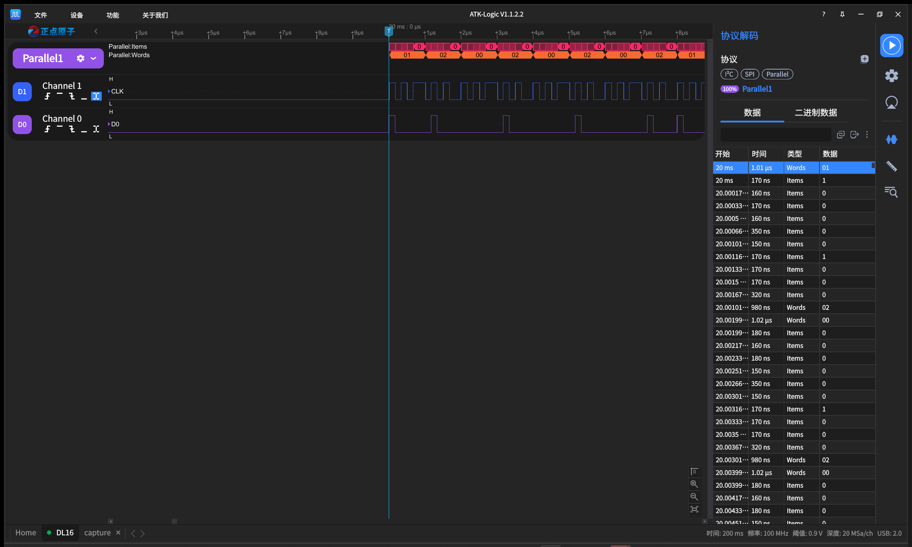
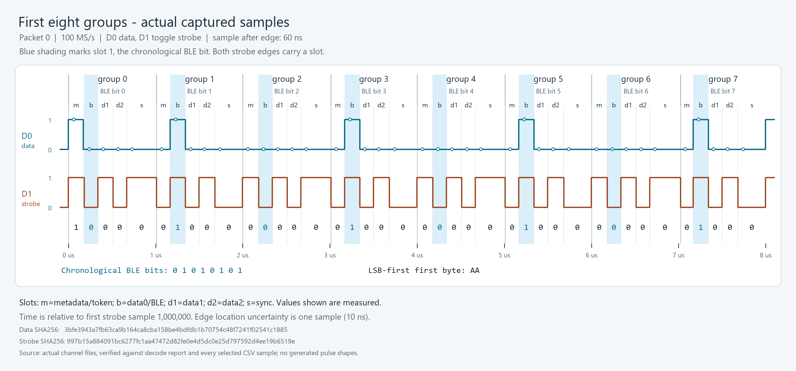

# 在 ATK-Logic 原生界面人工核对 BLE 包头

日期：2026-11-16，Asia/Shanghai。[完整进度与交接](PROGRESS.md) · [仓库首页](../../README.md)

**本轮已经结束。用户理解后要求停止，全部 GUI 操作已结束。以下是可移交的人工参考步骤，只有以后用户明确要求复核时才使用，不是自动继续采集或操作设备的指令。不要重新连接 RIGOL 示波器。**

本次在设备页原生重采 D0、D1，使用软件自带 Parallel，未安装额外协议解码器。最终截图已视觉确认首八个 Words 为 `01 02 00 02 00 02 00 02`，逐组提取 bit1 后为前导码 `AA`。第 9–40 组 Access Address 是后续核对目标；本次没有逐字节视觉认证全部 AA，也没有完成新原生记录的整包 CRC。



## 1. 先理解物理通道

- 物理 D0 接 FPGA BB7，信号为 `air_tx_o`，是数据。
- 物理 D1 接 FPGA BD9，信号为 `air_tx_strobe_o`，是 strobe。
- 公共 GND 已由用户确认。
- “strobe”是物理信号的用途；协议菜单不必出现一个叫 strobe 的选项。
- 官方 CLI 与 GUI 独占 USB，不能同时占用 DL16。

旧 CLI 离线工程曾有 D1 整行空白的问题，原因未解释；不能称作“缩放修好了”。本次原生重采能同时显示双通道。旧工程的两路原始数据已独立逐点核对完整，详见[进度记录](PROGRESS.md)。

## 2. 原生采集参数

将来获准重采时，在底部 DL16 设备标签页、绿色连接标志旁进入设备页，点击右侧齿轮，核对以下设置：

| 设置 | 本次原生采集实际值 |
|---|---|
| 通道 | 只启用物理 D0、D1 |
| 采样频率 | 100 MHz，每点 10 ns |
| 记录时长 | 200 ms |
| 采样深度 | 20 MSa/ch |
| 阈值 | 自定义 0.9 V |
| 模式 | Buffer |
| 触发 | D0 的触发图标全不选；D1 选最右侧“任意边沿” |
| 触发位置 | 10% |
| 采集方式 | 正常、单次 |

获准执行新采集时，点击右上角蓝色开始按钮，等待自然完成。本次 D0 紫色、D1 蓝色都有活动，记录中可见 8 段活动，首段起点约在 20 ms 的 T 标记处。8 段可见活动不能代替完整包或 CRC 验证。

采集的“任意边沿”决定何时触发记录；解码器的 `either` 决定读取哪些 strobe 边沿，两处都要正确。

## 3. 使用自带 Parallel

在“协议解码”面板点击协议旁的 `+`，搜索 `parallel`，选择 `Parallel`：

| Parallel 参数 | 设置 |
|---|---|
| CLK / Clock line | 物理 D1：Channel 1 |
| D0 / Data line 0 | 物理 D0：Channel 0 |
| D1–D15 / 其他 Data line | 全部保持 `-` |
| RST | `-` |
| Clock edge to sample on | `either` |
| Data wordsize (# bus cycles) | `5` |
| Data endianness | `little` |
| Start / End | 完整记录范围 |

**解码器的 Data line 1 必须不分配。** 物理 D1 已作 CLK，若再把它作为第二根并行数据线，结果会变成两位宽总线。

确认后等解码进度到 100%，查看 Items 和 Words 行及右侧结果表。最终界面的显示名称为 `Parallel1`，只是名称，协议仍为软件自带 Parallel。

## 4. 每个五位字怎样对应 BLE 位

每个 strobe 上升、下降沿都传输一个位置。每五个位置组成一组：

```text
时间顺序：tag → data0/BLE → data1 → data2 → sync
字内位号：b0      b1        b2      b3      b4
word = tag + 2×BLE + 4×data1 + 8×data2 + 16×sync
BLE = (word >> 1) & 1
```

Words 的 `01`、`02` 等是五位传输字，**bit1 才是本组 BLE 位**。每组取一位后，再把八组按 LSB-first 组合成一个 BLE 字节。

| Words（十六进制） | b4…b0 | 提取 b1 / BLE |
|---|---|---:|
| 00 | 00000 | 0 |
| 01 | 00001 | 0 |
| 02 | 00010 | 1 |
| 03 | 00011 | 1 |
| 12 | 10010 | 1，同时 sync=1 |

CLI 记录的稳定窗口检查确认 BLE 1M 的 data1、data2 均为 0；内置 Parallel 的边沿即时读数仍可能受切换瞬间影响，参见第 7 节。tag 是传输元数据；它重复组成 `0x80`，不能用来替代 BLE 去白化信道 37。

## 5. 已视觉确认的首八组

定位第一个包，按时间读前八个 Words。以下是最终原生截图确认的实际值：

| 用户组号（1 起） | 1 | 2 | 3 | 4 | 5 | 6 | 7 | 8 |
|---|---:|---:|---:|---:|---:|---:|---:|---:|
| Words | 01 | 02 | 00 | 02 | 00 | 02 | 00 | 02 |
| bit1 / BLE | 0 | 1 | 0 | 1 | 0 | 1 | 0 | 1 |
| 字节内权重 | 1 | 2 | 4 | 8 | 16 | 32 | 64 | 128 |

```text
0×1 + 1×2 + 0×4 + 1×8 + 0×16 + 1×32 + 0×64 + 1×128
= 170 = 0xAA
```

时间序列 `01010101` 的左端是先发的 b0，右端才是 b7。直接把它当成最高位在左的二进制数，会把 BLE 字节顺序读反。

## 6. 第 9–40 组的人工核对目标

下表给出 CLI 严格解码已确认的字段和原生手工复核目标，**不表示本次原生截图已视觉验证这些 AA 字节**：

| 用户组号 | 按时间提取的 BLE 位，左端先发 | LSB-first 字节 |
|---|---|---|
| 1–8 | 0 1 0 1 0 1 0 1 | AA，原生已确认 |
| 9–16 | 0 1 1 0 1 0 1 1 | D6，原生待逐组核对 |
| 17–24 | 0 1 1 1 1 1 0 1 | BE，原生待逐组核对 |
| 25–32 | 1 0 0 1 0 0 0 1 | 89，原生待逐组核对 |
| 33–40 | 0 1 1 1 0 0 0 1 | 8E，原生待逐组核对 |

线上的字节顺序为 `AA D6 BE 89 8E`；Access Address 数值写作 `0x8E89BED6`。
第 40 组的第五位置 sync 应为 1，对应 `[tag,BLE,data1,data2,sync]=[0,1,0,0,1]`，little 五位字为十六进制 `12`。

本文组号从 1 开始；离线 CSV 的 `group_index` 从 0 开始，因此第 40 组对应 CSV 39。实际核对时逐组记录原生读数，不要因与目标不同就删除边沿、跳组或修改数据。

## 7. 用实际波形确认采样位置

组内 strobe 跳变约间隔 166.7 ns，跨组边界约 333.3 ns；每组约 1 µs。内部时钟 12 MHz，串行位置推进节拍 6 MHz，每组传五个位置。

将包头放大到能分清每个 strobe 跳变。对每组第二个边沿，在边沿后 **+60 ns，即 100 MHz 下六个采样点**观察 D0 的稳定高低；正式 CLI 解码还检查了 +40 至 +80 ns 稳定窗口。



上图来自已严格解码的 CLI 100 ms 记录，与前面的原生 200 ms 截图属于两次不同采集。

Parallel 在边沿即时取数，没有延迟 60 ns 的设置。数据恰好在边沿附近变化时，非 BLE 位置可能显示上一状态，应回到波形稳定区复核。旧 CLI 记录的全部 BLE 位曾比较即时与 +60 ns 取样，结果一致；这不能代替对新原生记录的检查。

## 8. 保存结果与汇报范围

本次已用 **File → Save As** 保存原生 `native_capture.atkdl`；Ctrl+Shift+S 未注册成功。工程与原始文件保留在原机器，路径和 SHA-256 见[完整交接](PROGRESS.md)，本仓库不包含 ATKDL。

最终保留在首包约 20 ms 的包头，视图相对首边沿约 −7.8 µs 至 +8.7 µs；D1 蓝色、D0 紫色，旧 capture 标签页保留，File 菜单关闭，解码进度 100%。为了保留用户看到的状态，没有再关闭并重开工程测试。

对他人说明时，保持以下证据范围：

- 双通道原生波形和 Parallel 证明数据、strobe 与五位分组可在软件内查看。
- 首八个原生 Words 已视觉确认，抽取 bit1、LSB-first 组合为前导码 `AA`。
- 第 9–40 组的 Access Address 是手工核对目标，不能汇报成此次已全部视觉认证。
- Parallel 不会自动从每五位抽取 BLE 位，也不会自动去白化或计算 BLE CRC。
- Header 从第 41 组起使用信道 37 白化；完整 PDU 和 CRC 的已通过结论来自 CLI 四包的严格离线解码。

用户已经要求停止。此指南保留读数方法和后续复核目标，未来没有自动执行的 GUI 待办。
