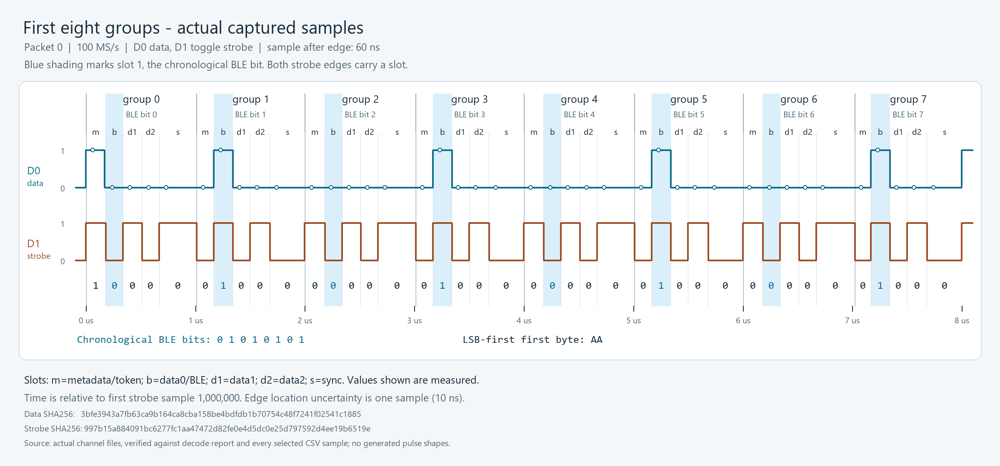
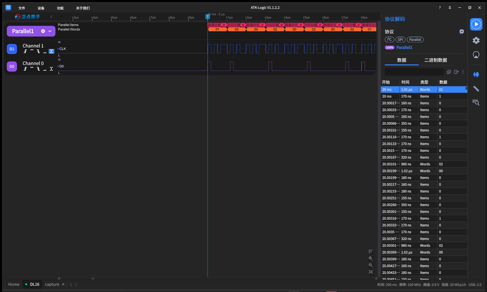

# VU13P 四线 BLE / DL16：完整进度与交接

记录日期：**2026-11-16，Asia/Shanghai**。本文是已完成工作的记忆快照。

**当前状态：用户在理解原生界面的读数方法后要求停止，全部 GUI 操作已结束。已有结果已保存，没有遗留的后台采集作业、自动目标或待执行硬件任务。新上下文不要自动重做或继续硬件验证。**

[仓库首页](../../README.md) · [原生 GUI 人工核对指南](MANUAL_CHECK.md)

## 1. 已完成的结论与操作边界

| 项目 | 已完成的事实 | 证据范围 |
|---|---|---|
| 上电恢复 | FPGA bit 重新配置成功；固件重载并独立读回校验，恢复广播 | 已完成；采集期间没有 JTAG halt |
| 官方 CLI 采集 | `capture_05`，100 MHz / 100 ms / 0.9 V / Buffer | 4/4 完整包严格通过 |
| 离线完整解码 | 每包 1480 个 strobe 边沿、296 组、296 BLE 位、37 字节 | 前导码、AA、AD、sync、CRC 均通过 |
| 原始数据一致性 | CLI 生成 ATKDL 的两个通道还原内部偏移后与 BIN 逐点相同 | 每通道 10,000,000 点，差异 0 |
| 原生 GUI 新采集 | 100 MHz / 200 ms / 0.9 V，D0、D1 同时显示活动 | 可见 8 段活动；不等同于验证 8 个完整包 |
| 原生 Parallel 读数 | 首八个 Words 视觉确认，提取 bit1 得到前导码 `AA` | 只确认前八组；未新增原生整包 CRC 结论 |
| 保存与交付 | 两套本地 ZIP、原生 ATKDL 与最终截图已保存 | 大型数据与工程留在原机器 |

继续时必须保留以下约束：

- 用户明确确认过公共 GND，不能把此前问题解释为“尚未接地”。
- 用户说的“不要连接了”指 **RIGOL 示波器**；不要重新连接 RIGOL。
- 用户已要求停止；阅读本记忆不构成重新连接 DL16、烧写、JTAG/UART 或 GUI 操作的授权。
- 官方 CLI 与 ATK-Logic GUI 独占 USB，不能同时占用 DL16。
- 最终 CLI 解码未删除边沿、未纠错、未插位、未补位，不能用修整后的数据替代最终原始结果。
- 对今后的新要求先读现有证据，只做必要的续接；用户不喜欢反复确认和冗长的重复验证。

## 2. 工作里程碑

所有时刻均为 2026-11-16 的 Asia/Shanghai 本地时间。

| 阶段 | 实际情况与处理结果 |
|---|---|
| 初始诊断 | 边沿触发等待不到信号；无边沿条件采集显示 D0 恒低、D1 恒高。用户确认 FPGA 当天重新上过电。 |
| 13:25 起，上电恢复 | 使用前一天已验证的 bit 和固件，重新配置 FPGA、写固件、独立读回验证并启动。 |
| 阈值比较 | 0.6 V 记录到 10–20 ns 短跳变；0.8 V 有 1/4 包通过；0.9 V 的最终记录 4/4 通过。 |
| 13:44:59.592，最终 CLI | `capture_05` 连续记录 100 ms，自然结束，状态 complete，CLI 会话正常关闭。 |
| CLI 结果整理 | 生成严格解码报告、逐组与逐边沿 CSV、真实采样图、离线交互查看器、ATKDL 一致性报告及 ZIP。 |
| 原生 GUI 复核 | 在设备页重新采集 200 ms，使用软件自带 Parallel 显示双通道及五位字；未安装自定义协议。 |
| 原生保存 | 通过 File → Save As 保存工程；工程文件时间 16:01:23。最终截图读到完整首八个 Words。 |
| 终止操作 | 用户理解读数方法后要求停止；保留当前界面和本地材料，结束所有 GUI 动作。 |

阈值比较是本次数字采集的经验结果。LVCMOS12 约束给出了初始 0.6 V 的依据，但这些记录不能代替模拟电压幅度测量，也没有单凭阈值试验定位短跳变的模拟原因。

## 3. 板级恢复、接线与来源

| 信号 | 接线 / 含义 |
|---|---|
| DL16 物理 D0 | FPGA BB7，`air_tx_o`，数据 |
| DL16 物理 D1 | FPGA BD9，`air_tx_strobe_o`，strobe |
| GND | 用户已确认连接 FPGA GND |
| I/O 约束 | LVCMOS12 |
| DL16 标识 | `dl16:1186554909` |

FPGA 型号为 `xcvu13p-fhgb2104-2L-e`；本轮使用的硬件版本为 `ad9cac8116cb6ce9dd0f61806fa272f1a9bcf613`，Zephyr 固件版本为 `f147a531658`。板级配置启用 `.CevaVphy4Wire(1'b1)` 四线模式；本次观察的是发送方向的数据与 strobe 两路。
相关实现保存在本机 `scope_mapping` 中的 `vphy_2wire.sv`、`rw_ble_whitening.v`、`rw_ble_crc.v`、`rw_ble_bit_stream.v`，固件对照文件为 `acceptor_main_f147a531658.c`。

恢复使用的输入文件保持原路径：

```text
C:\eb_bringup\qsfp0_irqfix_20261115_1208\delivery\chip_englishbreakfast_vu13p_qsfp0_irqfix.bit
C:\eb_bringup\qsfp0_irqfix_20261115_1208\delivery\acceptor_sched_diag.bin
C:\eb_bringup\qsfp0_irqfix_20261115_1208\scope_mapping\
```

| 恢复项目 | 已记录结果 |
|---|---|
| bit SHA-256 | `83122ff22d18d7e9d45743d97777c38ec1983cb0a5b3fc975ad41cdbeb8a4f4c` |
| 固件 SHA-256 | `e086c4f6727dfc3c2e05497599d40df8798026f67553d56516d1e2f987f08cbb` |
| FPGA 配置 | Vivado 5 MHz，约 188 秒，startup=HIGH、DONE=1 |
| 固件写入与验收 | J-Link 将 PC 停在 ROM `0x00008100` 后写入，重新连接并独立读取校验全部 274,940 字节，返回 `Verify successful.` |
| 启动 | 从 `0x10000000` 启动；UART `advertising err=0`，调度持续推进，诊断错误为 0 |
| 采集结束时 | COM14 已释放，固件保持运行；采集期间没有 JTAG halt |

恢复只解释并解决了本轮上电后无活动的问题。后续若板子再断电，不能假设 FPGA 易失配置和 RAM 固件仍然存在；是否重新加载要由用户的新任务决定，不能自动执行本机恢复脚本。

## 4. 最终 CLI 采集设置

| 参数 | `capture_05` 实际值 |
|---|---|
| 采样率 / 间隔 | 100 MHz / 10 ns |
| 连续记录时间 | 100 ms，单次 Buffer |
| 每通道深度 | 10,000,000 个有效采样点 |
| 比较阈值 | 0.9 V |
| 触发 | D1 任意边沿，D0 忽略 |
| 预触发 | 10%，即 10 ms |
| 输出 | 两路 BIN、采集元数据、ATKDL |
| 离线取样 | 每个 strobe 边沿后 +60 ns 读取 D0 |
| 稳定性检查 | 边沿后 40–80 ns 稳定窗口 |
| 完成状态 | 自然结束、complete；会话正常关闭 |

原始 BIN 按每字节 bit0 最早解包，并严格使用各通道 `validBits`。
旧 CLI 工程在 GUI 右侧显示过程序默认属性；实际参数以本地 `capture_05/capture.json` 与 `capture_05_config.json` 为准，不能从离线属性控件反推本次硬件采集条件。

## 5. 严格完整包结果

| 包序号（0 起） | 首 strobe 在记录中的时刻 | 与上一包起点间隔 | 边沿数 | 组 / BLE 位数 | 全部检查 |
|---|---:|---:|---:|---:|---|
| 0 | 10.00000 ms | — | 1480 | 296 / 296 | 通过 |
| 1 | 32.50013 ms | 22.50013 ms | 1480 | 296 / 296 | 通过 |
| 2 | 57.50026 ms | 25.00013 ms | 1480 | 296 / 296 | 通过 |
| 3 | 81.87539 ms | 24.37513 ms | 1480 | 296 / 296 | 通过 |

四包内容相同，每包 37 字节。每包的分组时序错误、稳定窗口歧义和两个未使用数据位的非零组数均为 0；sync 只出现在零基 `group_index=39`。

完整性判定保留真实空闲边界、所有五位组、时序及稳定性检查，再分别检查实际长度、前导码、Access Address、AD 和 CRC。最终结果没有按预期字节删边沿、改位或补齐不完整包。

这是 100 ms 有线四线 PHY 发送位流的实测结论；没有据此宣称完成射频收发、无线链路或长时间稳定性验证。

## 6. 从物理边沿到 BLE 位

发送内部时钟为 12 MHz，串行位置推进节拍为 6 MHz。每个 BLE 1M 位对应一组，五个 strobe 跳变承载五个位置：

```text
按时间：tag → data0/BLE → data1 → data2 → sync
组内间隔约 166.7 ns；跨组边界约 333.3 ns；每组周期约 1 µs。
上升沿和下降沿都传输一个位置，每组第二个位置才是 BLE 位。
```

本次 `data1`、`data2` 都为 0。tag 按传输约定重复组成 `0x80`，属于传输元数据，必须与 BLE 逻辑白化信道 37 分开理解。

**本文“第 N 组”从 1 开始；CSV `group_index` 从 0 开始。** 第 1 组就是 CSV 0，第 40 组就是 CSV 39。

| 用户组号 | CSV 索引 | 对应内容 |
|---|---|---|
| 1–8 | 0–7 | 前导码，时间序列 `0 1 0 1 0 1 0 1`，LSB-first 为 `AA` |
| 9–40 | 8–39 | AA：线上字节 `D6 BE 89 8E`，数值写法 `0x8E89BED6` |
| 第 40 组第五位置 | 39 的 sync | 此处为 1，其余组为 0 |
| 41–56 | 40–55 | 去白化 Header `20 1B` |
| 57–104 | 56–103 | 去白化 AdvA `01 23 45 67 89 AB` |
| 105–272 | 104–271 | 去白化 AD，共 21 字节 |
| 273–296 | 272–295 | 去白化 CRC `C1 9E 64` |

下图由 CLI 的真实原始采样生成，标出了前八组与延迟采样点，未用预期字节重建波形。



CSV 中 `ble_air_bit` 是实测线数据，`dewhitened_ble_bit` 是按信道 37 去白化后的位。

## 7. 完整字节与广播字段

原始线上 37 字节；前五字节之后仍为白化数据：

```text
AA D6 BE 89 8E AD C9 56 82 78 C0 EF 1B 77 30 13 59
91 76 F8 B1 FC 27 AA A5 13 52 7C F5 C1 38 D9 BF 47
FA 62 15
```

去白化后的 37 字节，按字段换行：

```text
AA D6 BE 89 8E
20 1B
01 23 45 67 89 AB
02 01 02
11 07 01 00 52 BA CE 01 75 8D 01 4F 2D 7B A0 D1 9B 8C
C1 9E 64
```

| 字段 | 解释 |
|---|---|
| PDU | ADV_IND，type 0 |
| Header | `20 1B`，ChSel=1，TxAdd=0，RxAdd=0，payload 长度 27 字节 |
| AdvA | 公共地址 `AB:89:67:45:23:01`；线上按 `01 23 45 67 89 AB` 发送 |
| AD 长度 | 21 字节；加 6 字节 AdvA 为 payload 27 字节 |
| `02 01 02` | Flags，LE General Discoverable |
| `11 07 ...` | 完整 128-bit Service UUID 列表 |
| UUID | `8c9bd1a0-7b2d-4f01-8d75-01ceba520001` |
| Local Name | 当前 AD 没有设备名 `OT-CEVA-DM-A` |
| CRC | 线上白化后的末三字节为 `FA 62 15`；去白化后为 `C1 9E 64` |

## 8. 白化与 CRC 约定

前导码与 Access Address 不白化；从第 41 组（零基 BLE bit 40）起，对 Header、AdvA、AD 和 CRC 连续去白化，逻辑信道为 **37**。

| 算法表达 | 初始值与递推约定 |
|---|---|
| 标准右移白化寄存器 | 种子 `0x65`（`0x40` 与信道号 `37` 按位或）；输出 bit0，右移反馈掩码 `0x44` |
| RTL 左移白化寄存器 | 七位反序种子 `0x53`；输出旧 bit6，左移反馈掩码 `0x11` |
| RTL CRC | 左移，初值 `0x555555`，多项式 `0x00065B`，先发送 state[23] |
| 反射 CRC 表达 | 右移，反序初值 `0xAAAAAA`，反射多项式 `0xDA6000` |

两套白化表达、两套 CRC 表达分别是不同寄存器位序下的等价写法。不能只替换初值或移位方向，也不能将 transport token `0x80` 当成白化信道。

当前 PDU 计算的 RTL CRC 状态为 `0x837926`；按发送位顺序再以 LSB-first 组字节得到 `C1 9E 64`，与去白化后的接收值相同。
离线报告还记录了固定 CRC 参考向量通过，以及 40 个信道、各 512 位的独立左右移白化等价检查；算法检查不增加硬件采样证据的范围。

## 9. 旧 CLI 工程的 D1 显示问题

旧 CLI 离线工程曾在 GUI 里出现 **D0 可见、D1 整行空白** 的情况。D1 空白的 GUI 原因没有得到解释，不能写成“缩放已修好”。

已经完成的独立检查是：将 `capture_05/capture.atkdl` 作为 ZIP 读取内部通道块，按每通道 `channel.ini` 第二行给出的头偏移跳过 6 个采样点，再与官方 BIN 逐点比较。

| 通道 | 跳过头偏移 | 比较点数 | 不一致点数 | BIN SHA-256 |
|---|---:|---:|---:|---|
| D0 | 6 点 | 10,000,000 | 0 | `3bfe3943a7fb63ca9b164ca8cba158be4bdfdb1b70754c48f7241f02541c1885` |
| D1 | 6 点 | 10,000,000 | 0 | `997b15a884091bc6277fc1aa47472d82fe0e4d5dc0e25d797592d4ee19b6519e` |

因此不能据 GUI 的 D1 空白断言工程丢失 D1 数据；直接把 ZIP 内部块当成零偏移 BIN 也会产生错误比较。原生 GUI 重新采集能正常显示双通道活动，这一事实不解释旧工程的显示机制。

## 10. 原生 GUI 新采集与 Parallel

原生采集与 CLI 最终记录是两次不同采集。

| 原生采集参数 | 实际值 |
|---|---|
| 频率 / 时长 | 100 MHz / 200 ms |
| 深度 | 20 MSa/ch |
| 通道 | 仅物理 D0、D1 |
| 阈值 / 模式 | 0.9 V / Buffer |
| 触发 / 预触发 | D1 任意边沿，D0 不触发 / 10% |
| 可见现象 | 8 段发包活动；首段起点在记录约 20 ms |

使用 **软件自带 Parallel**，未安装额外协议解码器：

| Parallel 参数 | 配置 |
|---|---|
| CLK | 物理 D1 / Channel 1 |
| Data line 0 | 物理 D0 / Channel 0 |
| 其余 Data line / RST | 全部 `-`，特别是解码器 Data line 1 不分配 |
| Clock edge | `either`，同时取上升与下降沿 |
| Data wordsize | `5` |
| Data endianness | `little` |
| 显示名称 | `Parallel1`，只是界面名称 |

五位字为 `word = tag + 2×BLE + 4×data1 + 8×data2 + 16×sync`，每个 Words 的 **bit1** 才是 BLE 位。
最终原生截图已视觉核对首八个 Words：

```text
Words（十六进制）：01 02 00 02 00 02 00 02
逐组提取 bit1：    0  1  0  1  0  1  0  1
按 LSB-first：     0xAA
```



第 9–40 组应还原 AA 的 `D6 BE 89 8E`，这是[手工核对指南](MANUAL_CHECK.md)中的后续核对目标；此次没有逐字节视觉认证四个 AA 字节，也没有对新原生记录完成整包去白化或 CRC。

Parallel 在边沿即时取样，没有 +60 ns 选项；原生读数如涉及边沿附近状态，应回到 D0 稳定区复核。旧 100 ms CLI 记录的全部 BLE 位曾比对即时取样与 +60 ns 取样，结果一致；该结论不能自动延伸到新的原生记录。

## 11. 最终保留状态与有效文件

- 软件留在原生采集首段约 20 ms 的包头，视图相对该首边沿约为 −7.8 µs 至 +8.7 µs。
- D1 蓝色、D0 紫色，前八个 Words 可读；旧 capture 标签页保留。
- File 菜单已关闭，Parallel 解码进度 100%；用户已要求停止操作。
- 原生工程通过 File → Save As 保存；为避免改变界面，没有再进行关闭并重开工程测试。
- 原生工程本地文件为 `native_capture.atkdl`，16,492 字节，文件时间 16:01:23。
- 最终有效截图为 `native_first8_saved.png`，两个代理交叉核对过完整首八字。
- 早期 `native_first8.png` 是 60–90 ms 视图；`native_first8_verified.png` 只显示六个字。它们不能当成最终首八组证据。

| 有效材料 | SHA-256 |
|---|---|
| 原生 `native_capture.atkdl` | `aa90c17d211d473c4c3d895886e2e5f730f8882f85c255bc3ab5d00a68d667e9` |
| 原生 `native_first8_saved.png` / 仓库原生图片 | `252dea89ed99ea8d3b3c44d84c3bd55c670dcb15d5d7ba93f991bf8088bcbf8c` |
| CLI `figures_05/first_8_groups.png` / 仓库 CLI 图片 | `3011bab744f6324e1ac2019e6d4ca7bad0b8a52a4655f0f0cc2afeafd9215640` |

## 12. 本机材料定位

以下是机器本地路径，不是仓库内文件；换机器后需要从原机器取得相应材料。

```text
工作区：E:\Users\24242\Documents\deepseek-harness\default-workspace
CLI 根：E:\Users\24242\Documents\deepseek-harness\default-workspace\dl16_ble_capture_20261116_1304
原生根：E:\Users\24242\Documents\deepseek-harness\default-workspace\dl16_gui_verify_20261116_1407
仓库：E:\Users\24242\Documents\deepseek-harness\default-workspace\yxy_ai_memory
```

CLI 根目录内的主要材料：

| 本地相对路径 | 用途 |
|---|---|
| `RESULTS_CN.md` | 本轮 CLI 完整结论、参数与解码说明 |
| `capture_05_config.json`、`capture_05/capture.json` | 采集请求与实际采集元数据 |
| `capture_05/channel_0.bin`、`capture_05/channel_1.bin`、`capture_05/capture.atkdl` | 最终两路原始数据与工程 |
| `decode_05/report.json` | 全部四包、算法约定、输入及源码 SHA-256 |
| `decode_05/selected_packet.csv` | 296 行逐组 / BLE 位对应表 |
| `decode_05/selected_bits.csv` | 1480 行逐 strobe 边沿与采样点对应表 |
| `figures_05/first_8_groups.png`、`figures_05/capture_viewer.html` | 真实波形图与可离线交互查看器 |
| `project_integrity.json` | ATKDL 与 BIN 的逐点一致性 |
| `board_restore/inputs.json` | bit、固件输入路径与 SHA-256 |
| `board_restore/program_vivado.log` | FPGA 配置证据 |
| `board_restore/write_acceptor.log`、`board_restore/verify_acceptor.log` | 固件写入与独立校验 |
| `board_restore/start_acceptor.log`、`board_restore/uart_startup.log` | 启动及 UART 状态 |
| `restore_board.ps1` | 已完成恢复的本地脚本，只用于追溯，不自动执行 |
| `run_capture.py` | 官方 CLI JSONL 会话采集控制，访问设备 |
| `decode_capture.py`、`render_capture.py` | 离线解码、实际采样可视化 |
| `manifest.json`、`SHA256SUMS.txt` | CLI 交付文件大小与 SHA-256 |

原生根目录内的主要材料为 `MANUAL_CHECK_CN.md`、`native_manifest.json`、`native_capture.atkdl`、`native_first8_saved.png` 以及其他过程截图。
`gui_control.py` 是本地 GUI 自动化辅助，最终版本含前台 PID、真实鼠标坐标与 `WindowFromPoint` 保护；任何将来获准使用前都先读当前文件。

两份 ZIP 均留在本地，**没有作为本仓库的进度文档附件上传**：

| 本地根 / 文件 | 大小 | 校验 / 内容 |
|---|---:|---|
| CLI 根 / `DL16_BLE_verified_20261116.zip` | 192,406 字节 | SHA-256 `a1fd39d4b06289fe8ff89fddfd10558217e87d5b7b25a8a85fbad4d63a002213` |
| 原生根 / `DL16_native_manual_verification_20261116.zip` | 835,443 字节 | 指南、原生 ATKDL、截图、manifest |

仓库仅保存本文、[手工指南](MANUAL_CHECK.md)、[项目索引](../../README.md)和上述两张图片。不复制原始日志、BIN、固件、bitstream、完整 ZIP、API Key 或凭据。

## 13. 新上下文如何恢复记忆与离线复算

1. 先读本页的停止状态与证据范围，再读[手工指南](MANUAL_CHECK.md)。
2. 只需解释结论或写报告时，使用现有文档与两张图片即可；不要重复采集。
3. 需要逐位追溯且仍在原机器时，先读 CLI 根中的 `decode_05/report.json` 和两份 CSV。
4. 用户明确要求离线复算时，可使用现有原始记录，输出到新的目录，保留原始结论与证据。
5. 用户明确提出新的设备任务时，先确认任务具体目标与本机当前状态；不要把之前已完成工作当作待办，也不要重连 RIGOL。

以下命令只对现有 CLI 数据做离线复算和出图，不连接设备。它们是交接示例，本轮文档整理没有再次执行：

```powershell
$python = 'C:\Users\24242\.dsh\dsh-runtimes\dsh-primary-runtime\dependencies\python\python.exe'
$cliRoot = 'E:\Users\24242\Documents\deepseek-harness\default-workspace\dl16_ble_capture_20261116_1304'
& $python "$cliRoot\decode_capture.py" "$cliRoot\capture_05" --output-dir "$cliRoot\decode_review_new" --auto-map
& $python "$cliRoot\render_capture.py" "$cliRoot\capture_05" "$cliRoot\decode_review_new" --output-dir "$cliRoot\figures_review_new"
```

执行前选择尚不存在的复算输出目录。解码器使用采集元数据确定采样率和有效位数，不能用 GUI 默认属性覆盖这些数据；渲染器会校验原始文件与报告的 SHA-256，并核对 CSV 采样点。

采集入口是本地 `run_capture.py`，其调用的官方程序在 `C:\Program Files\ATK-Logic_ZHEN_DIAN_YUAN_ZI\atk-logic-cli.exe`。这里只记录入口，不安排新的采集命令。若将来用户另行要求采集，须先在 GUI 保存并正常释放 USB，配置新的输出路径及新的会话日志名；自然结束且 idle 才算完成，异常的 `.bin.partial` 保留原状，不得改名成完整数据。

## 14. 未来获准操作 GUI 时的已知坑

本节用于避免重复踩坑，不是本次或新上下文的自动操作清单。

- 实际 ATK-Logic 位于左侧副屏，物理窗口矩形 `(-2571, -11, 11, 1539)`，全图 2582×1550；坐标可为负数。截图与点击应采用 per-monitor DPI-aware、`all_screens` 和窗口相对坐标。
- 最小化时窗口矩形会落到 `-32000`，不能按该矩形点击。
- 协议模态窗口可见时主窗口处于 disabled；应聚焦启用的所属对话框，不能强行把 disabled 主窗口作为目标。
- QML 下拉框的 Home / Down 键选择不可靠，实际用鼠标选择并核对当前值。
- Ctrl+Shift+S 未注册成功；已验证的原生另存方式是 File → Save As。
- 本地 `gui_control.py` 曾被代理修订；先读当前版本，再判断前台 PID、鼠标实位和点击窗口保护是否满足新任务。

## 15. 尚未完成或无法断言的事项

- 旧 CLI 离线工程的 D1 空白显示原因未定位；ATKDL 原始通道数据完整的结论已单独验证。
- 原生 GUI 只完成首八组视觉核对；第 9–40 组 AA 与原生新记录的完整 PDU / CRC 没有完成验证。
- 原生工程保存后没有再关闭并重开测试，不能声称已验证重开后的视图恢复。
- 没有用这些数字记录证明模拟幅度、射频行为或长时可靠性。

这些是证据边界，不是待自动执行的任务。用户已要求停止，未来代理应从已完成状态接续用户的新问题。
